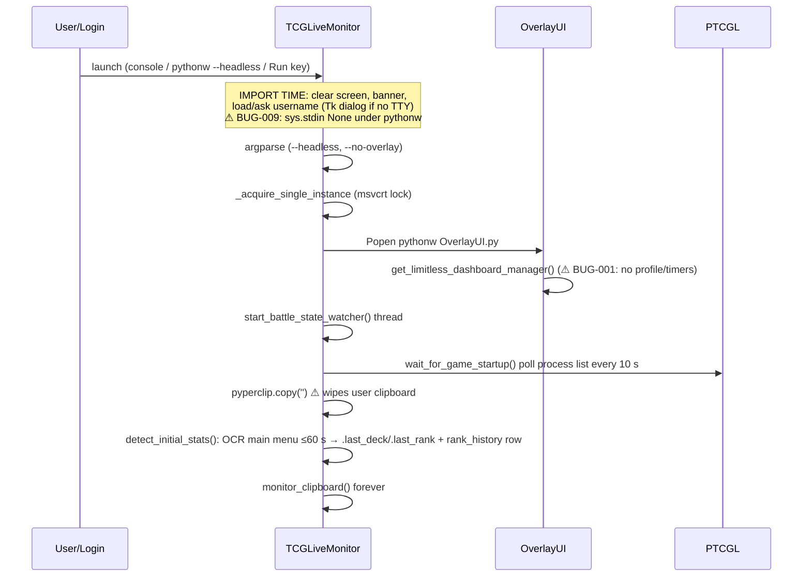
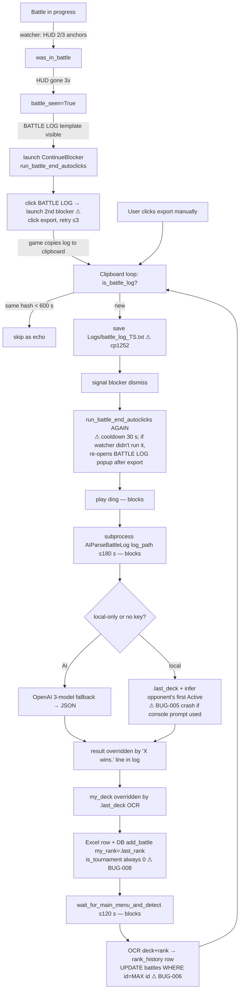

# Process Map

## 1. Startup

## 2. Battle lifecycle (the core loop)

Key timing fact: the clipboard loop is **single-threaded**. From the moment a log is detected until the main-menu OCR finishes, up to about 5 minutes, no other clipboard content is examined (BUG-018).

Observed in `Logs/autoclicker.log`: in most battles the sequence runs *after* the log already arrived (user exported by hand). The export button then is "not found within 20s", and on 2026-09-13 22:26 the watcher fired, both blockers showed, the export never happened, and that battle is **missing** from the DB.

## 3. Overlay refresh
- Every 1 s `follow_game_window()`: find the window titled exactly "pokemon tcg live", pin the HUD bottom-right, write a debug line to `.overlay_debug.log` (unbounded, BUG-019).
- Every 3 s `load_stats()`: `rank_history` latest → Elo, `MAX(rank)` → Max, `session_stats` today → W-L.
- Every 5 s: is the `.monitor_pid` process alive? If not → quit.
- Double-click stats → reset today's W/L (lost on the next edit/delete because of `rebuild_session_stats`).
- ▲ → opens StatsWindow (created fresh each time; `WA_DeleteOnClose`).

## 4. Stats dashboard open
`StatsWindow.__init__` → builds 10 tabs eagerly, including **3 QWebEngineViews that start loading immediately** (Limitless dashboard, ptcglreplay, pokedata) → `load_stats()` → in 1.2 s, a MetaFetcher thread for Limitless standard (15 tournaments + one request per deck page + sprites). Refreshes every 15 s, but only while the window is **not** focused (protected interaction).

## 5. Limitless tournament flow (as designed vs actual)
Designed:
1. Background hidden page on `/dashboard` → every 60 s run the check-in scan JS.
2. If a check-in button is found → auto-click (or show alert).
3. If an active `/match/` link is found → load it in a hidden chat page → every 3 s extract chat → overlay chat bubble window + `.chat_capture.json`.
4. Opponent from chat header → `.in_tournament` → parser tags the battle as tournament (weight ×3).

Actual (because of BUG-001, BUG-008, BUG-017):
- Nothing loads in the background until the dashboard window is opened once.
- Even then, `_on_background_load_finished` throws `AttributeError`, so the 60 s poll timer **never starts**, and chat polling never starts either.
- The `inTournament` regex matches almost any dashboard page, so `.in_tournament` = `{"in_tournament": true, "opponent": ""}` sits on disk (current state).
- The parser never calls `is_tournament_battle()`, so no battle has ever been tagged (all 39 rows have `is_tournament=0`).

## 6. Replay
Battle row click → `open_battle_replay` → rebuild a throwaway WebEngine profile → load ptcglreplay.com → inject the log file via a JS `DataTransfer` drop. Fallback: Playwright (not installed) → default browser + Explorer selecting the log to drag in (`_open_replay_manually`).
