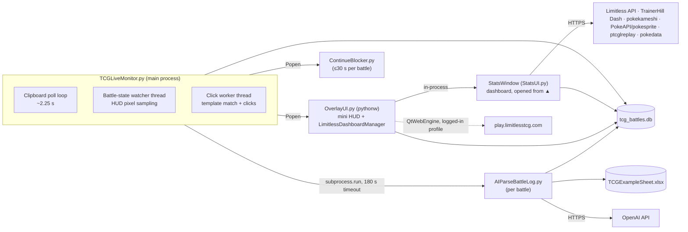

# System Overview

**What it is:** a Windows-only Python app that sits beside Pokémon TCG Live (PTCGL), captures every battle log, figures out decks, result and rank, stores them in SQLite, and shows stats in a small in-game overlay plus a big dashboard. The dashboard also pulls meta data (Limitless, TrainerHill, Japan) and embeds the Limitless tournament dashboard with auto check-in.

Version in code: `###Version=2.3` (monitor), but `OverlayUI.VERSION`/`StatsUI.VERSION` still say `2.1`.
Size: ~16.2k lines of Python; `StatsUI.py` alone is 8.2k lines (one file, ~50% of the codebase).

## Processes at runtime

| Process | Launched by | Lifetime | Notes |
|---|---|---|---|
| `TCGLiveMonitor.py` | console bat, `Run_Headless.py`, registry Run key, scheduled task | forever | Single-instance via `msvcrt.locking` on `.monitor_lock` |
| `OverlayUI.py` | Monitor `start_overlay()` (pythonw) | quits when `.monitor_pid` process dies | Hosts the **Limitless manager** and the **StatsWindow** in-process |
| `AIParseBattleLog.py` | Monitor, once per detected log | ≤180 s (monitor kills it) | Writes DB + Excel |
| `ContinueBlocker.py` | Monitor click worker / watcher | ≤30 s, `os._exit` on fade-out | Topmost window over the game's Continue button |
| Playwright replay helper | StatsUI fallback | until browser closed | Only when WebEngine missing; Playwright isn't in requirements |

## Components (by layer)
- **Capture:** [[TCGLiveMonitor]] (clipboard and HUD watcher), [[AutoClicker and ContinueBlocker]], [[RankDetector and BattleState]] (OCR + pixel checks)
- **Interpretation:** [[AIParseBattleLog]] (OpenAI or local fallback), OCR deck name override
- **Storage:** [[BattleDatabase]] (SQLite) + loose dot-files and caches ([[Data Model]])
- **Presentation:** [[OverlayUI]] (mini HUD + chat bubble window), [[StatsUI]] (dashboard)
- **Analytics:** [[deck_analytics]] (Bayesian/Wilson/rank-weighted), [[japan_data]]
- **Integrations:** [[Limitless Dashboard Manager]] (QtWebEngine, auto check-in, chat capture), MetaFetcher (Limitless API, TrainerHill)
- **Ops:** [[Startup and Installers]] (registry/schtasks, Inno Setup, wizard, bats)

## Cross-process communication (all via files in the app folder)
There is no IPC. Processes coordinate through files in `BASE_DIR`, which makes the whole design race-prone:
- `.monitor_pid` / `.monitor_lock`: overlay liveness check and single instance
- `.last_rank`, `.last_deck`: OCR results from the monitor → parser
- `.in_tournament`, `.chat_capture.json`: Limitless manager (overlay process) → parser
- `Logs/.blocker_dismiss`: monitor → ContinueBlocker
- `tcg_battles.db`: shared by 4 processes, with no WAL and no busy-timeout tuning
Full list: [[Data Model]].

## External dependencies
Tesseract OCR (bundled `tesseract/` or Program Files), OpenAI API (optional), PySide6 (+WebEngine), matplotlib (Qt5Agg backend resolves to PySide6, which was verified to work), mss/opencv/pytesseract, pywin32, pyautogui (**missing from requirements**, see BUG-012), `mouse`.

## Platform assumptions
Windows only (`win32gui`, `winreg`, `msvcrt`, `os.startfile`). The game window is found by title; OCR regions are percentages of the window (see `screen_regions.json`). Button templates are pixel-exact, so they break if the window size changes.
